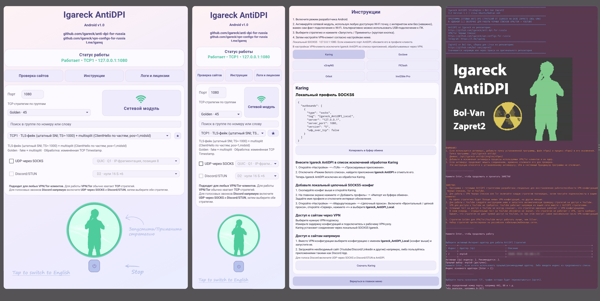

<h1 align="center"><code> IGARECK ANTI-DPI </code></h1>

<h2 align="center"><code> READY-TO-USE ANTI-DPI STRATEGIES FOR BLACKLIST VPN SUBSCRIPTIONS AND TOR </code></h2>

<h3 align="center"> Built to restore Blacklist VPN configurations and Tor bridge connectivity in Russia </h3>
<h3 align="center"> Designed to bypass Roskomnadzor's TSPU traffic filters </h3>

<div align="center">

[](https://github.com/igareck/anti-dpi-for-russia/releases)
[](https://github.com/igareck/anti-dpi-for-russia/releases)
[](https://github.com/igareck/anti-dpi-for-russia/releases)

[](https://t.me/igareq)
[](https://www.patreon.com/igareck/shop)

**🌐 Язык: [Русский](README.md) | 🌐 Language: [English](README-EN-US.md)**

</div>

<div align="center">



</div>

```diff
+ This program was originally developed to restore access to public VPN subscriptions and Tor bridges.
- Direct access to YouTube, Discord, Facebook, LinkedIn, and X (Twitter) without a VPN
- is an additional benefit of some strategies.
```

### **`Can this program get Blacklist VPN subscriptions and Tor bridges working again in Russia?`**

**It can help restore access to VPN servers and Tor bridges.**

**Try Igareck AntiDPI if a large VPN subscription has only a couple of reachable servers, or none respond to latency tests, or Tor bridges are slow.**

Start **Igareck AntiDPI**, apply one strategy at a time, and test your VPN subscription or Tor bridge in your client. The number of reachable VPN servers varies by strategy. Start with the first Golden strategies and compare the results on your connection.

For example, Tor bridges can connect faster and transfer data at higher speeds. An obfs4 bridge may also work on a connection where it previously failed.

### **`How can I check whether Igareck AntiDPI is working?`**

1. First, run a latency test on **[BLACK_VLESS_RUS_mobile.txt](https://raw.githubusercontent.com/igareck/vpn-configs-for-russia/refs/heads/main/BLACK_VLESS_RUS_mobile.txt)**, **[BLACK_SS+All_RUS.txt](https://raw.githubusercontent.com/igareck/vpn-configs-for-russia/refs/heads/main/BLACK_SS%2BAll_RUS.txt)**, or **[BLACK_VLESS_RUS.txt](https://raw.githubusercontent.com/igareck/vpn-configs-for-russia/refs/heads/main/BLACK_VLESS_RUS.txt)** with **Igareck AntiDPI** disabled.
2. Enable **Igareck AntiDPI** and select a strategy, starting with the first **Golden** strategies.
3. Run the latency test again in your VPN client.
4. Compare the number of reachable servers.
5. **Profit!**

### **`Which VPN and Tor clients are compatible with Igareck AntiDPI?`**

**Any client**, including **[Karing](https://github.com/KaringX/karing/releases), [v2rayN](https://github.com/2dust/v2rayN/releases), [v2rayNG](https://github.com/2dust/v2rayNG/releases), [Exclave](https://github.com/ExclaveNetwork/Exclave/releases), [Throne](https://github.com/throneproj/Throne/releases), [Clash Verge Rev](https://github.com/clash-verge-rev/clash-verge-rev/releases), [FlClash](https://github.com/chen08209/FlClash/releases), [OnionHop V3](https://github.com/center2055/OnionHop/releases), [OnionFruit](https://github.com/dragonfruitnetwork/onionfruit/releases/latest), [Orbot](https://github.com/guardianproject/orbot-android/releases), and [InviZible Pro](https://github.com/Gedsh/InviZible/releases)**.

On **Windows and Linux**, the program runs in the background with its default settings.

On **Android**, the VPN or Tor client connects to the local SOCKS5 proxy at `127.0.0.1:1080`.

### **`What strategies are included? What do Golden and Silver mean?`**

**484 strategies** across 23 families, including 45 Golden and 439 Silver strategies.

See **[README_Стратегии_Windows_v1.0.txt](windows/README_Стратегии_Windows_v1.0.txt)** for a detailed guide to all strategies.

Golden strategies may work more reliably than Silver for VPNs and Tor or for direct access to sites such as YouTube, Discord, and LinkedIn.

### **`Can I use Igareck AntiDPI to watch YouTube on my PC without a VPN?`**

On Windows and Linux, enter `YouTube` in the strategy menu to run the automated check. Strategies marked `PASS` should let you open YouTube in a browser without a VPN.

On Android, use **Website checks** to test YouTube and other sites.

**The main purpose of Igareck AntiDPI is to restore VPN and Tor connectivity.** Direct access to YouTube is an additional benefit. Some Golden strategies may also open Discord, LinkedIn, Facebook, Threads, X.com, and parts of the Tor Project website.

### **`Can I make Discord calls with Igareck AntiDPI without a VPN?`**

Yes. On Android, enable **UDP over SOCKS** and **Discord/STUN** and choose a strategy for each. 

Windows and Linux currently support TCP strategies. Discord voice support is planned for those platforms.

After changing a strategy, tap the round **Start / Apply** button again to apply it.

### **`Does a successful check for YouTube, Discord, or LinkedIn mean a strategy will restore more VPN servers?`**

Test direct website access and VPN subscription connectivity separately. A strategy may fail to open YouTube directly and still make the most VPN servers reachable.

### **`What is the program based on, and what makes it useful?`**

The program uses [Zapret2](https://github.com/bol-van/zapret2) by [Bol-Van](https://github.com/bol-van), [Lua 5.4.9](https://lua.org/) on Android, [LuaJIT](https://luajit.org/) on Windows and Linux, [Shizuku-API](https://github.com/RikkaApps/Shizuku-API), [WinDivert](https://github.com/basil00/WinDivert), [Cygwin](https://cygwin.com/git.html), and other components.

**Igareck AntiDPI** comes with ready-to-use TCP, UDP, and Discord strategies. Choose the one that works best on your connection.

The program and its strategies have been tested on mobile and wired networks in Russia. It is intended for users of public VPN subscriptions and Tor bridges and for people accessing YouTube and Discord.

On Android, Windows, and Linux, menus let you configure, select, test, and restart strategies while the program is running.

The desktop CLI guides you through each step. Enter the requested `number`, `да` or `нет` (`yes` or `no`), or `youtube`.

### `Which platforms are supported?`

**[Android 11+](https://github.com/igareck/anti-dpi-for-russia/releases)** ★ **[Windows 10/11 x64](https://github.com/igareck/anti-dpi-for-russia/releases)** ★ **[Linux Ubuntu/Debian x64](https://github.com/igareck/anti-dpi-for-russia/releases)**

---

## Installation and Getting Started

## `Android 11+`

<details>
<summary><code> Click to expand </code></summary>

㋡

The universal `Igareck_AntiDPI_v1.0_Android_11+_Universal.apk` supports Android 11 and later on `arm64-v8a`, `armeabi-v7a`, and `x86_64`.

Igareck AntiDPI listens on a local SOCKS5 proxy for your VPN or Tor client. The default port is `1080`.

### 1. Install the APK

**[Download Android v1.0 (APK)](https://github.com/igareck/anti-dpi-for-russia/releases/tag/v1.2)**

Open the downloaded APK and confirm installation. If Android asks you to allow installation from this source, grant permission to the app you used to open the APK.

### 2. Activate the network module

Enable Android Developer options, then open **Network module** on the main screen.

In Android Settings, find **Build number** under device information and tap it seven times to enable Developer options.

**You can activate the module over Wi-Fi or over USB from a computer.**

### **Over Wi-Fi**

1. Connect to a Wi-Fi network. An internet connection is optional for pairing.
2. Enable **Wireless debugging** in Developer options.
3. In Igareck AntiDPI, open **Network module** and allow notifications for entering the pairing code.
4. Tap **Start pairing**.
5. Open **Developer options → Wireless debugging** and select **Pair device with pairing code**.
6. Keep the Android code dialog open. Enter the six-digit code in the Igareck notification and tap **Send**.
7. Return to the activation screen and wait for **Network module active**.
8. If automatic pairing fails, use the manual port and code fields on the activation screen.

The **Network module** screen also walks through these steps.

### **Over USB from a computer**

1. Enable **USB debugging** in Developer options. Use a data cable to connect the unlocked device to your computer and confirm Android's **Allow USB debugging?** prompt.
2. Download and extract **[Android SDK Platform-Tools](https://developer.android.com/tools/releases/platform-tools)** for your computer.
3. In Igareck AntiDPI, open **Network module → Activate via USB (with a computer when Wi-Fi is unavailable)** and follow the steps. The app and the **[USB guide in Russian](android/USB_ACTIVATION_RU.txt)** list the commands for Windows, Linux, and macOS.

### 3. Set up your client and start a strategy

1. Open **Instructions** in the Android app and choose your client.

   Exclude Igareck AntiDPI from the apps routed through the VPN client to prevent a routing loop.

   Add a local SOCKS5 profile at `127.0.0.1:1080`.

   Configure the client to access sites through the VPN or directly.

2. Start with the Golden group and choose a TCP strategy. Tap the round **Start / Apply** button to start it. Tap it again after changing a strategy.

   For direct Discord voice calls, enable **UDP over SOCKS** and **Discord/STUN**, then choose both strategies.

3. In **Website checks**, test TCP strategies for direct access to YouTube, Discord, LinkedIn, Facebook, X, and Threads. Turn off the VPN client while testing.

   Test VPN servers and Tor bridges in their respective clients separately from the website checks.

4. Tap **Stop** to stop the strategy. To shut down the module itself, open **Network module → Stop network module**.
5. Open **Logs and licenses** for diagnostics, log export, and full license texts.

</details>

## `Windows 10/11 x64`

<details>
<summary><code> Click to expand </code></summary>

㋡
  
### **1. Run the installer.**

**[INSTALL USING THE EXE](https://github.com/igareck/anti-dpi-for-russia/releases/download/v1.2/Igareck_AntiDPI_CLI_v1.0_Windows_x64.exe)**

Double-click **Igareck_AntiDPI_CLI_v1.0_Windows_x64.exe**.
Approve the request to run as administrator.

**[INSTALL FROM THE ZIP ARCHIVE](https://github.com/igareck/anti-dpi-for-russia/releases/download/v1.2/Igareck_AntiDPI_CLI_v1.0_Windows_x64.zip)**

Extract **Igareck_AntiDPI_CLI_v1.0_Windows_x64.zip**, open the **Igareck_AntiDPI_CLI_v1.0_Windows_x64** folder, and run **УСТАНОВКА.cmd**.
Approve the request to run as administrator.

### **2. Read the `ВНИМАНИЕ` (Warnings) and `ЗАМЕТКИ` (Notes) sections, then press Enter to continue.**

### **3. Choose an installation folder.**

Press **Enter** to use the default folder, **`C:\Igareck_AntiDPI`**.

Or enter a different installation path.

### **4. Choose the engine version by entering its number.**

1 — the most compatible Zapret2 version, pinned to the commit used to test the current release of **Igareck AntiDPI**.

2 — the latest Zapret2 version from the official master branch.

### **5. Enter `yes` (or `да`) to create a desktop folder with shortcuts, installation instructions, and the strategy reference.**

### **6. Wait for installation to finish.**

---
---

*THE PROGRAM STARTS AUTOMATICALLY WHEN INSTALLATION FINISHES.*

*TO START THE INSTALLED PROGRAM AGAIN, USE THE `START_Igareck_AntiDPI` SHORTCUT IN THE `Igareck_AntiDPI` FOLDER ON YOUR DESKTOP, OR RUN `ЗАПУСК_Igareck_AntiDPI_Zapret2.cmd` IN THE INSTALLATION FOLDER.*

---
---

### **7. Enter the number of the active internet adapter to use with the AntiDPI strategies.**

The program recommends an available physical adapter connected to the internet.

On a typical system with a single physical adapter, you can simply press **Enter** to accept the default. The program selects it automatically.

If your system has multiple adapters and you are unsure which one to choose, check them under `Control Panel` → `Network and Internet` → `Network and Sharing Center` → `Change adapter settings`.

### **8. Choose the destination TCP ports whose traffic Zapret2 will intercept.**

`For VPN subscriptions`, select all ports, since configurations in public subscriptions can use many different ports. For a single server, its known TCP port is enough.

`For a Tor bridge`, you can either select all ports or enter the port specified in the bridge configuration.

`For YouTube in a browser without a VPN`, port 443 is sufficient for the browser traffic covered here.

You can enter a single port, a range, a comma-separated combination, or `all` / `все`.

Press **Enter** with the field blank to select all ports (`all` / `все`). Example: `80,443,1000-2000`.

### **9. The strategy table appears.**

| | | | | |
|:---:|:---:|:---|:---:|:---:|
|**#**|**Set**|**Family**|**Count**|**Strategy numbers**|
|1|Golden|fake + multisplit|13|1-13|
|2|Golden|multisplit + multisplit|7|14-20|
|3|Golden|fake + multidisorder|1|21|
|4|Golden|Named hostfakesplit|11|22-32|
|5|Golden|Real ClientHello + fake + multisplit|13|33-45|
|6|Silver|fake + multisplit|35|46-80|
|7|Silver|multisplit + multisplit|12|81-92|
|8|Silver|fake + multidisorder|1|93|
|9|Silver|Named hostfakesplit|49|94-142|
|10|Silver|Real ClientHello + fake + multisplit|30|143-172|
|11|Silver|fake|4|173-176|
|12|Silver|fake + fake + fakeddisorder|25|177-201|
|13|Silver|fake + fake + multidisorder|8|202-209|
|14|Silver|fake + fake + multisplit|5|210-214|
|15|Silver|fake + fakeddisorder|127|215-341|
|16|Silver|fake + fakedsplit|67|342-408|
|17|Silver|fake + hostfakesplit|1|409|
|18|Silver|fake + tcpseg|1|410|
|19|Silver|fakedsplit|18|411-428|
|20|Silver|hostfakesplit|28|429-456|
|21|Silver|multisplit + fakeddisorder|22|457-478|
|22|Silver|tcpseg|2|479-480|
|23|Silver|Large TLS prefix / multisplit|4|481-484|
| | | | | |


### **10. Enter a `strategy number` from the table, or type `YouTube`.**

```diff
The table groups the strategies into families.
The first column contains the family number.
The second column shows the strategy set: Golden or Silver.
Golden strategies may work better than Silver for VPNs, Tor, and YouTube.
The third column contains the family name.
The last column lists the individual strategy numbers.
```

**a. To start an AntiDPI strategy right away**, enter its `number` from the last column on the right.

**b. To check strategies for YouTube access**, enter `youtube` instead of a number. Then enter a range, such as `1-50`, or a single strategy number. To speed up the check, choose how many strategies to test at once: any number from `1` to `5`.

Strategies that pass the check appear as a list: `3 (PASS), 5 (PASS), 4 (PASS), 2 (PASS), 1 (PASS), 6 (PASS), 7 (PASS), 8 (PASS), 9 (PASS), 10 (PASS), 11 (UNSTABLE), 12 (PASS), 13 (PASS), 15 (PASS), 14 (PASS)`

The menu will then ask you to **enter a `strategy number` or `YouTube`** again. Enter the number of a strategy that passed, then press **Enter** to start it. You can now open YouTube in your browser.

```diff
a. Passing the YouTube check does not always mean a strategy works well with VPN configurations.
b. Failing the YouTube check does not mean a strategy will fail with VPNs. It can be the other way around.
c. A strategy may not provide direct YouTube access but may still get the largest number of VPN configurations to work.
```

### **11. Once the strategy is running, test and connect to configurations in your VPN client (Karing is recommended), or check YouTube in your browser without a VPN.**

A VPN configuration that only works with **Igareck AntiDPI**, and does not even respond to a latency check without it, may need 5–20 seconds to begin passing traffic. After connecting to a configuration that passed the check, give it 5–20 seconds before deciding it is not working.

Use **Igareck AntiDPI** with these **Blacklist VPN subscriptions** (for networks with blacklist-based filtering): **[BLACK_VLESS_RUS_mobile.txt](https://raw.githubusercontent.com/igareck/vpn-configs-for-russia/refs/heads/main/BLACK_VLESS_RUS_mobile.txt)** or **[BLACK_SS+All_RUS.txt](https://raw.githubusercontent.com/igareck/vpn-configs-for-russia/refs/heads/main/BLACK_SS%2BAll_RUS.txt)** or **[BLACK_VLESS_RUS.txt](https://raw.githubusercontent.com/igareck/vpn-configs-for-russia/refs/heads/main/BLACK_VLESS_RUS.txt)**.

### **12. Controls available while the program is running.**

`TO STOP THE CURRENT STRATEGY AND CHOOSE ANOTHER, press F1`

Opens the menu for selecting a strategy or checking YouTube access.

`TO RESTART THE CURRENT STRATEGY, press F2`

Stops the current *winws2.exe* process and starts a new one with the same strategy and adapter.

`TO CHANGE THE NETWORK ADAPTER OR PORTS, press F3`

Stops the current *winws2.exe* process and displays the available active physical IPv4 adapters, including the recommended adapter.

You can then choose the TCP ports whose traffic Zapret2 will intercept.

The new process starts with the same strategy.

`TO STOP AntiDPI/ZAPRET2 AND EXIT, press CTRL+C`

Stops the current *winws2.exe* process and exits the program.

### **13. Running or uninstalling the program.**

**To run:**

1. Use the **START_Igareck_AntiDPI** shortcut in the **Igareck_AntiDPI** folder on your desktop.
2. Run **ЗАПУСК_Igareck_AntiDPI_Zapret2.cmd** in the installation folder.

**To uninstall:**

1. Use the **DELETE_Igareck_AntiDPI** shortcut in the **Igareck_AntiDPI** folder on your desktop.
2. Run **УДАЛИТЬ_Igareck_AntiDPI_Zapret2.cmd** in the installation folder.

---
---

</details>

## `Linux Ubuntu/Debian x64`

<details>
<summary><code> Click to expand </code></summary>

㋡

### **1. Run the installer.**

**[INSTALL FROM THE TAR.GZ ARCHIVE](https://github.com/igareck/anti-dpi-for-russia/releases/download/v1.2/Igareck_AntiDPI_CLI_v1.1_Linux_x64.tar.gz)**

Open a terminal in the folder containing the downloaded archive and run:

```bash
tar -xzf Igareck_AntiDPI_CLI_v1.1_Linux_x64.tar.gz
cd Igareck_AntiDPI_CLI_v1.1_Linux_x64
bash INSTALL.sh
```

### **2. Read the `ВНИМАНИЕ` (Warnings) and `ЗАМЕТКИ` (Notes) sections, then press Enter to continue.**

### **3. Choose an installation folder.**

Press **Enter** to use the default folder, **`/opt/igareck-antidpi`**.

Or enter a different installation path.

### **4. Choose the engine version by entering its number.**

1 — the most compatible Zapret2 version, pinned to the commit used to test the current release of **Igareck AntiDPI**;

2 — the latest Zapret2 version from the official master branch.

### **5. Enter `yes` (or `да`) to create a desktop folder with shortcuts, installation instructions, and the strategy reference.**

### **6. Wait for installation to finish.**

---
---

*THE PROGRAM STARTS AUTOMATICALLY WHEN INSTALLATION FINISHES.*

*TO START THE INSTALLED PROGRAM AGAIN, USE THE `START_Igareck_AntiDPI` SHORTCUT IN THE `Igareck_AntiDPI` FOLDER ON YOUR DESKTOP, OR FIND IT IN YOUR APPLICATIONS MENU, OR RUN `START.sh` IN THE INSTALLATION FOLDER, OR ENTER `igareck-antidpi` IN A TERMINAL FROM ANY DIRECTORY.*

---
---

### **7. Enter the number of the active internet adapter to use with the AntiDPI strategies.**

The program recommends an available physical adapter connected to the internet.

On a typical system with a single physical adapter, you can simply press **Enter** to accept the default. The program selects it automatically.

If your system has multiple adapters and you are unsure which one to choose, inspect them in another terminal with:

```bash
nmcli device status
```
or
```bash
netstat -i
```
or
```bash
ifconfig
```
or
```bash
ip -br address
```

### **8. Choose the destination TCP ports whose traffic Zapret2 will intercept.**

`For VPN subscriptions`, select all ports, since configurations in public subscriptions can use many different ports. For a single server, its known TCP port is enough.

`For a Tor bridge`, you can either select all ports or enter the port specified in the bridge configuration.

`For YouTube in a browser without a VPN`, port 443 is sufficient for the browser traffic covered here.

You can enter a single port, a range, a comma-separated combination, or `all` / `все`.

Press **Enter** with the field blank to select all ports (`all` / `все`). Example: `80,443,1000-2000`.

### **9. The strategy table appears.**

| | | | | |
|:---:|:---:|:---|:---:|:---:|
|**#**|**Set**|**Family**|**Count**|**Strategy numbers**|
|1|Golden|fake + multisplit|13|1-13|
|2|Golden|multisplit + multisplit|7|14-20|
|3|Golden|fake + multidisorder|1|21|
|4|Golden|Named hostfakesplit|11|22-32|
|5|Golden|Real ClientHello + fake + multisplit|13|33-45|
|6|Silver|fake + multisplit|35|46-80|
|7|Silver|multisplit + multisplit|12|81-92|
|8|Silver|fake + multidisorder|1|93|
|9|Silver|Named hostfakesplit|49|94-142|
|10|Silver|Real ClientHello + fake + multisplit|30|143-172|
|11|Silver|fake|4|173-176|
|12|Silver|fake + fake + fakeddisorder|25|177-201|
|13|Silver|fake + fake + multidisorder|8|202-209|
|14|Silver|fake + fake + multisplit|5|210-214|
|15|Silver|fake + fakeddisorder|127|215-341|
|16|Silver|fake + fakedsplit|67|342-408|
|17|Silver|fake + hostfakesplit|1|409|
|18|Silver|fake + tcpseg|1|410|
|19|Silver|fakedsplit|18|411-428|
|20|Silver|hostfakesplit|28|429-456|
|21|Silver|multisplit + fakeddisorder|22|457-478|
|22|Silver|tcpseg|2|479-480|
|23|Silver|Large TLS prefix / multisplit|4|481-484|
| | | | | |

### **10. Enter a `strategy number` from the table, or type `YouTube`.**

```diff
The table groups the strategies into families.
The first column contains the family number.
The second column shows the strategy set: Golden or Silver.
Golden strategies may work better than Silver for VPNs, Tor, and YouTube.
The third column contains the family name.
The last column lists the individual strategy numbers.
```

**a. To start an AntiDPI strategy right away**, enter its `number` from the last column on the right.

**b. To check strategies for YouTube access**, enter `youtube` instead of a number. Then enter a range, such as `1-50`, or a single strategy number. To speed up the check, choose how many strategies to test at once: any number from `1` to `5`.

Strategies that pass the check appear as a list: `3 (PASS), 5 (PASS), 4 (PASS), 2 (PASS), 1 (PASS), 6 (PASS), 7 (PASS), 8 (PASS), 9 (PASS), 10 (PASS), 11 (UNSTABLE), 12 (PASS), 13 (PASS), 15 (PASS), 14 (PASS)`

The menu will then ask you to **enter a `strategy number` or `YouTube`** again. Enter the number of a strategy that passed, then press **Enter** to start it. You can now open YouTube in your browser.

```diff
a. Passing the YouTube check does not always mean a strategy works well with VPN configurations.
b. Failing the YouTube check does not mean a strategy will fail with VPNs. It can be the other way around.
c. A strategy may not provide direct YouTube access but may still get the largest number of VPN configurations to work.
```

### **11. Once the strategy is running, test and connect to configurations in your VPN client (Karing is recommended), or check YouTube in your browser without a VPN.**

A VPN configuration that only works with **Igareck AntiDPI**, and does not even respond to a latency check without it, may need 5–20 seconds to begin passing traffic. After connecting to a configuration that passed the check, give it 5–20 seconds before deciding it is not working.

Use **Igareck AntiDPI** with these **Blacklist VPN subscriptions** (for networks with blacklist-based filtering): **[BLACK_VLESS_RUS_mobile.txt](https://raw.githubusercontent.com/igareck/vpn-configs-for-russia/refs/heads/main/BLACK_VLESS_RUS_mobile.txt)** or **[BLACK_SS+All_RUS.txt](https://raw.githubusercontent.com/igareck/vpn-configs-for-russia/refs/heads/main/BLACK_SS%2BAll_RUS.txt)** or **[BLACK_VLESS_RUS.txt](https://raw.githubusercontent.com/igareck/vpn-configs-for-russia/refs/heads/main/BLACK_VLESS_RUS.txt)**.

### **12. Controls available while the program is running.**

`TO STOP THE CURRENT STRATEGY AND CHOOSE ANOTHER, press F1 (or s)`

Opens the menu for selecting a strategy or checking YouTube access.

`TO RESTART THE CURRENT STRATEGY, press F2 (or r)`

Restarts the strategy by starting a new process with the same strategy and adapter.

`TO CHANGE THE NETWORK ADAPTER OR PORTS, press F3 (or i)`

Displays the available active physical IPv4 adapters, including the recommended adapter.

You can then choose the TCP ports whose traffic Zapret2 will intercept.

The new process starts with the same strategy.

`TO STOP AntiDPI/ZAPRET2 AND EXIT, press CTRL+C (or q)`

Exits the program.

### **13. Running or uninstalling the program.**

**To run:**

1. Use the **START_Igareck_AntiDPI** shortcut in the **Igareck_AntiDPI** folder on your desktop.
2. Use the **Igareck_AntiDPI** shortcut in your Applications Menu.
3. Run **START.sh** in the installation folder.
4. Enter **`igareck-antidpi`** in a terminal from any directory.

**To uninstall:**

1. **Standard uninstall: keeps logs and modified files.**

Run this command in a terminal:

```bash
sudo bash /opt/igareck-antidpi/DELETE.sh
```
Or use the **DELETE_Igareck_AntiDPI** shortcut in the **Igareck_AntiDPI** folder on your desktop.

2. **Full uninstall: removes the entire installation folder.**

```bash
sudo bash /opt/igareck-antidpi/DELETE.sh --purge
```

If you installed the program elsewhere, replace `/opt/igareck-antidpi` with your installation path.

</details>

---

## Building from Source

Instructions for building the **Windows ZIP/EXE** and **Linux TAR.GZ** packages from source are in **[packaging/BUILDING.md](packaging/BUILDING.md)**.

See the **[Android build guide](android/BUILDING.md)** for the APK.

Ready-to-install packages are available in **[Releases](https://github.com/igareck/anti-dpi-for-russia/releases)**.

---

##  Use the internet freely and responsibly!

## 🔖 License

Licensed under GPL-3.0. See **[`LICENSE`](LICENSE)** for the full text.

See third-party notices for **[Windows and Linux](THIRD_PARTY_NOTICES.md)** and **[Android](android/THIRD_PARTY_NOTICES.md)**.

##  `Support the Author`

**This is a noncommercial passion project.**

**If you would like to support the project, there are three options: a `donation through Patreon.com`, `Telegram Stars`, or `cryptocurrency`.**

Donations help keep this work going and support future development.

Thank you to everyone who chooses to contribute!

### 1. Donate through `Patreon.com/igareck`

[](https://www.patreon.com/igareck/shop)

In Russia, Patreon is only accessible through a VPN.

Payment options for users in Russia include:

**`International bank cards`**

**`Virtual cards issued outside Russia`**

**`App Store and Google Play: in-app Patreon payments on your phone`**

**`Third-party payment services (listed below)`**

The services below offer help paying for Patreon subscriptions, adding funds to App Store or Google Play accounts, or obtaining international Visa/Mastercard cards:

<details>
<summary><code><em> Click the arrow to view payment and transfer services </em></code></summary>

⇩

```diff

Paying for a Patreon subscription:
https://pyyplbot.com/kak-oplatit/patreon/
https://oplata.guru/patreon
https://oplatym.ru/patreon
https://sanpay.ru/instrustions/kak-oplatit-podpisku-na-patreon.html
https://getpayall.com/services/patreon

Getting an international Visa/Mastercard card or adding funds to one:
https://platipomiru.com/
https://wanttopay.net/
https://pyyplbot.com/bank-cards/
https://oplata.guru/zarubezhnaya-bankovskaya-karta
https://getpayall.com/individual

Adding funds to an Apple ID or Google Play account:
https://wanttopay.net/
https://oplata.guru/googleplay
https://oplatym.ru/googleplay

```

</details>

### 2. Send Telegram Stars to `t.me/igareq`

[](https://t.me/igareq)

### 3. Donate Cryptocurrency

<details>
<summary><code><em> Click the arrow to view cryptocurrency wallet addresses </em></code></summary>

⇩

Choose a cryptocurrency and copy its wallet address. Make sure you send it to the address listed for that coin and network; otherwise, your funds will be lost.

| # | Coin | Address |
|--|--|--|
| 1 | `Bitcoin (BTC)` | `18vVz4UzFdxCGnCnAzJtXv6ECsh32ff9VT` |
| 2 | `Ethereum network (ETH): Ethereum (ETH), USDC (ETH), USDT (Ethereum ERC-20), Shiba Inu (SHIB)` | `0xfc668016a823f3EE53d2F3009547666A2BdaBd32` |
| 3 | `Tron network (TRX): Tron (TRX), USDC (TRX), USDT (TRX)` | `TLnzF6NYgyqBHJMM2qByMXEHLBWNhBWcJ1` |
| 4 | `Toncoin network (TON): Toncoin (TON), Notcoin (NOT), Hamster Combat (HMSTR), USDT (USDT-TON)` | `EQAGbSuckE93yiACSENJGo8WuRq474Wba1J4yCF1Q59xsL0k` |
| 5 | `Litecoin (LTC)` | `LcHbh84V5PgWk1gTzjGWeef6NQT4MwE9RK` |
| 6 | `Ripple (XRP)` | `rNaKXrfLGsAVvA8JMr9dApMgCNzFmPbvTR` |
| 7 | `Monero (XMR)` | `47uvnonFqbyHMRrZadCAAvL2q9ed476PKdGtbLxXeUj1fs7gtPZ6mx3BeRBd2JM6Wmc16tN7K3ZcDMfds3cE8NaMCgAbD5Q` |
| 8 | `ZCash (ZEC)` | `t1cjEDjtLxatccB6o1pUPxb3pMByCz1L5Ct` |
| 9 | `Dogecoin (DOGE)` | `DRNBruzYDv5vWEz1ndGDjywqugVhd2Zmbm` |
| 10 | `Solana (SOL)` | `Hxm9MjxfD1LNKaWuiFFLzBDTR5CnJSty7gRnkTfubiWj` |
| 11 | `Stellar (XLM)` | `GDRN4K4VDDGNFIWJ3BAN7KL7576764RN44TBHTXYJIXMLK7RNP4UTSJ6` |
| 12 | `Cardano (ADA)` | `addr1qxpw4m02auvmrfee3suz98tvj82cm4mpfllvyda8fz004j40dpemdcuzntj5ykxwv2x6azyp982stfxegm9zvl9kf74s309qhu` |
| 13 | `NEAR Coin (NEAR)` | `d9cba0ec6233589267f43b91d8c156efb7fcd0a0177d7e8a34f7b791a61e7e35` |

</details>

<details>
<summary><code><em> Where can I buy cryptocurrency? </em></code></summary>

⇩

```diff

BestChange:
https://www.bestchange.com
https://www.bestchange.net
https://www.bestchange.ru
New BestChange website:
https://bestchange.biz/ru

```

</details>


##   Contact: igareck@proton.me

## 👀 Visitor Count
   


##  DISCLAIMER

> *This page is not an advertisement for VPN services. All material is provided solely for informational and research purposes, and is intended only for citizens of countries where access to this information is legal. If you are not permitted to read it, close this page immediately!*
>
> *The author does not intend to promote, encourage, or endorse the use of VPNs or any other software under any circumstances.*
>
> *Users are solely responsible for how they use VPN or AntiDPI software.*
>
> *The author is not responsible for the actions of third parties and does not encourage unlawful use of VPN or AntiDPI software.*
>
> *The author is not responsible for the accuracy, completeness, or reliability of the information published here. Any resemblance is purely coincidental. All information is provided "as is" and may not be accurate.*
>
> *Follow your local laws.*
>
> *Use VPN or AntiDPI software only for lawful and research purposes, such as improving your online security, providing secure remote access, and testing your connection speed. Do not use these technologies to bypass blocks under any circumstances.*
>
> *This is a free, noncommercial project. All payment details shown here were found online and copied "as is" solely as examples. They do not belong to the author.*
>
> *My advice? Close this page, uninstall every VPN and AntiDPI tool from your computer, install MAX and Yandex on all your devices so you can "stay connected" even in a parking lot, and use only the websites that your internet provider allows. You get the idea.*
