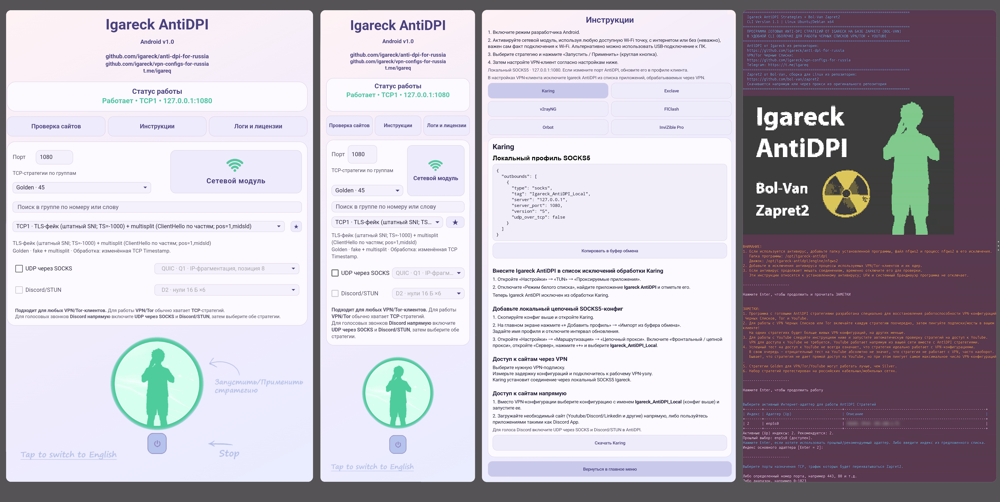

<h1 align="center"><code> IGARECK ANTI-DPI </code></h1>

<h2 align="center"><code> ПРОГРАММА ГОТОВЫХ ANTI-DPI СТРАТЕГИЙ ДЛЯ РАБОТЫ ЧЕРНЫХ СПИСКОВ VPN/TOR </code></h2>

<h3 align="center"> Разработана для восстановления работоспособности VPN-конфигураций Черных Списков и Tor-мостов в России </h3>
<h3 align="center"> Для обхода фильтров ТСПУ Роскомнадзора </h3>
 
<div align="center">

[](https://github.com/igareck/anti-dpi-for-russia/releases)
[](https://github.com/igareck/anti-dpi-for-russia/releases)
[](https://github.com/igareck/anti-dpi-for-russia/releases)

[](https://t.me/igareq)
[](https://www.patreon.com/igareck/shop)

**🌐 Язык: [Русский](README.md) | 🌐 Language: [English](README-EN-US.md)**

</div>

<div align="center">



</div>

```diff
+ Программа изначально разработана с целью восстановления работы публичных подписок VPN/Tor!
- Работоспособность Youtube, Discord, Facebook, Linkedin, X (Twitter) с Igareck AntiDPI,
- на некоторых стратегиях без VPN - это приятный бонус, но не главная цель проекта.
```

### **`Программа восстанавливает работоспособность VPN Черных списков и даже Tor мостов в России?`**

**Может буквально оживлять подписки.**

**Если в VPN-подписках ничего не пингуется (или пара конфигураций из большого списка) или тормозят мосты Tor - вам поможет эта программа.** 

Для работы с VPN Черных Списков или Tor-мостов, сначала запустите **Igareck AntiDPI** и включайте каждую стратегию поочередно, а затем пингуйте подписки/мосты в вашем клиенте!
На одних стратегиях может быть больше живых VPN-конфигураций, на других меньше. Выяснить, какие работают лучше, может только сам пользователь методом подбора. Начинайте с первых  Golden-стратегий.

Tor-мосты после запуска **Igareck AntiDPI**, например, подключаются быстрее, скорость трафика становится выше, а Obfs4-мосты работают там, где не работали раньше.

### **`Как понять, что Igareck AntiDPI работает?`**

1. Сначала пингуйте подписки ЧС **[BLACK_VLESS_RUS_mobile.txt](https://raw.githubusercontent.com/igareck/vpn-configs-for-russia/refs/heads/main/BLACK_VLESS_RUS_mobile.txt)** или **[BLACK_SS+All_RUS.txt](https://raw.githubusercontent.com/igareck/vpn-configs-for-russia/refs/heads/main/BLACK_SS%2BAll_RUS.txt)** или **[BLACK_VLESS_RUS.txt](https://raw.githubusercontent.com/igareck/vpn-configs-for-russia/refs/heads/main/BLACK_VLESS_RUS.txt)** без **Igareck AntiDPI** из открытой сети.
2. Затем включите **Igareck AntiDPI** и одну из стратегий, начиная с первых **Golden**.
3. Включите проверку задержки в VPN-клиенте еще раз.
4. Сравните прирост числа живых конфигураций.
5. **Профит!**

### **`С какими VPN/Tor-клиентами совместим Igareck AntiDPI?`**

**С любыми:** **[Karing](https://github.com/KaringX/karing/releases), [v2rayN](https://github.com/2dust/v2rayN/releases), [v2rayNG](https://github.com/2dust/v2rayNG/releases), [Exclave](https://github.com/ExclaveNetwork/Exclave/releases), [Throne](https://github.com/throneproj/Throne/releases), [Clash Verge Rev](https://github.com/clash-verge-rev/clash-verge-rev/releases), [FlClash](https://github.com/chen08209/FlClash/releases), [OnionHop V3](https://github.com/center2055/OnionHop/releases), [OnionFruit](https://github.com/dragonfruitnetwork/onionfruit/releases/latest), [Orbot](https://github.com/guardianproject/orbot-android/releases), [InviZible Pro](https://github.com/Gedsh/InviZible/releases)** и прочими. 

На **Windows и Linux** программа просто работает в фоне с настройками по умолчанию, никаких действий в VPN-клиенте не требуется. 

На **Android** VPN/Tor-клиент подключается к Igareck AntiDPI через локальный профиль SOCKS5 `127.0.0.1:1080`.

### **`Какие есть стратегии? Что за Golden и Silver разделения в таблице?`**

**484 стратегии:** 45 Golden + 439 Silver; 23 семейства.

Подробный справочник всех стратегий: **[README_Стратегии_Windows_v1.0.txt](windows/README_Стратегии_Windows_v1.0.txt)**

Стратегии Golden могут лучше обходить фильтры ТСПУ для работы VPN/Tor, а также для прямого доступа к заблокированным сайтам Youtube/Discord/LinkedIn и пр., то есть потенциально сильнее, чем стратегии Silver.

### **`Через Igareck AntiDPI можно смотреть YouTube без использования VPN?`**

Да, для работы с YouTube в версиях Windows/Linux запустите автоматическую проверку стратегий на доступ к YouTube в меню, где будет выбор между вводом `номера стратегии` и вводом слова `YouTube`. Стратегии, давшие ответ `PASS`, должны открыть YouTube в браузере без VPN.

В Android-версии проверка Youtube.com и других сайтов находится в меню «Проверка сайтов». 

**Первоочередная цель `Igareck AntiDPI` - это восстановление работы VPN/Tor, а прямой доступ YouTube - это приятный бонусный эффект.** На Golden-стратегиях могут также открываться Discord/Linkedin/Facebook/Threads/X.com и частично сайт Tor Project.

### **`Через Igareck AntiDPI можно звонить в Discord без использования VPN?`**

Да, для версии Android, кроме TCP-стратегий, были дополнительно разработаны стратегии `UDP через SOCKS` и `Discord/STUN`, которые позволяют совершать звонки в Discord. 

В компьютерные версии подобный функционал будет добавлен позже, пока что там только TCP-стратегии.

Для работы голосовых звонков в Android обе галочки `UDP через SOCKS` и `Discord/STUN` должны быть активированы, стратегии выбирайте из списка имеющихся.

После смены стратегии не забывайте повторно нажимать круглую кнопку `Применить`.

### **`Означает ли успешность проверки Youtube, Discord, LinkedIn и т.д., что стратегия восстанавливает больше VPN-конфигураций в подписках?`**
   
Успешный тест на доступ к сайту не означает, что стратегия лучше остальных работает с VPN-конфигурациями.

Доступ к сайтам напрямую и работоспособность VPN-подписок через AntiDPI никак не связаны, все проверяется отдельно друг от друга.

Бывает, что стратегия не дает прямой доступ на YouTube, но при этом пингует самое максимальное число VPN-конфигураций.

### **`На базе чего разработана программа и в чем ее преимущество?`**

Программа разработана на базе движка [Zapret2](https://github.com/bol-van/zapret2) ([Bol-Van](https://github.com/bol-van)), [Lua 5.4.9](https://lua.org/) для Android, [LuaJIT](https://luajit.org/) для Windows и Linux, [Shizuku-API](https://github.com/RikkaApps/Shizuku-API), [WinDivert](https://github.com/basil00/WinDivert), [Cygwin](https://cygwin.com/git.html) и других.

**Igareck AntiDPI** уже содержит готовые стратегии TCP/UDP/Discord для обхода фильтрации ТСПУ, где от пользователя требуется лишь подобрать лучшую из рабочих, а не искать с нуля.

Программа со стратегиями протестирована в российских мобильных/кабельных сетях и подойдет пользователям публичных подписок VPN/Tor + Youtube/Discord в России.

На Android, Windows и Linux программа адаптирована под рядового пользователя и завернута в удобную оболочку, с интуитивно понятным меню, возможностью настройки/выбора/теста/перезагрузки стратегий в процессе работы.

Для пользования компьютерными CLI-версиями специальных знаний командной строки (команд для терминала) не требуется. Все, что потребуется от пользователя - вводить `цифры`, `да`/`нет` или `youtube`. Система всегда подскажет, что нажать.

### `Какие платформы поддерживает?`

**[Android 11+](https://github.com/igareck/anti-dpi-for-russia/releases)** ★ **[Windows 10/11 x64](https://github.com/igareck/anti-dpi-for-russia/releases)** ★ **[Linux Ubuntu/Debian x64](https://github.com/igareck/anti-dpi-for-russia/releases)** 

---

## Инструкции по установке и запуску

## `Android 11+`

<details>
<summary><code> Нажмите чтобы открыть </code></summary>

㋡

**Универсальный APK `Igareck_AntiDPI_v1.0_Android_11+_Universal.apk`** подходит для Android 11 и новее на `arm64-v8a`, `armeabi-v7a` и `x86_64`. 

Igareck AntiDPI принимает трафик на локальном SOCKS5, к которому подключается VPN/Tor-клиент. Порт по умолчанию — `1080`.


### 1. Установите APK

**[Скачайте Android v1.0 (APK)](https://github.com/igareck/anti-dpi-for-russia/releases/tag/v1.2)**

 Откройте загруженный APK на Android и подтвердите установку. Если Android попросит разрешить установку из этого источника, то выдайте разрешение приложению.

### 2. Активируйте сетевой модуль

Чтобы запустить стратегии, необходимо активировать «Режим разработчика» в настройках Android, а затем «Сетевой модуль» из главного меню.

**Режим разработчика.** 

В настройках Android найдите «Номер сборки» и нажмите на него семь раз, чтобы включить/активировать параметры разработчика.

**Сетевой модуль активируется либо по Wi-Fi (самый простой вариант), либо альтернативно через USB.**

### **По Wi-Fi**

1. Подключитесь к Wi-Fi. Подойдет абсолютно любой доступный поблизости, с интернетом и без, это неважно, важен сам факт подключения к Wi-Fi-точке для активации.
2. Затем включите «Беспроводную отладку» («Отладка по Wi-Fi») в параметрах разработчика.
3. В Igareck AntiDPI откройте `Сетевой модуль`, разрешите уведомления для ввода кода (кнопка `Разрешить уведомления для ввода кода`).
4. Нажмите на кнопку `Начать сопряжение`.
5. Далее откройте «Беспроводную отладку» («Отладка по Wi-Fi»), нажав на кнопку `Параметры разработчика → Отладка по Wi-Fi` и уже в самом меню отладки нажмите «Сопряжение с помощью кода». 
6. Оставьте системное окно с кодом открытым и введите шестизначный код во всплывающем уведомлении Igareck и нажмите «Отправить». 
7. Вернитесь в меню активации сетевого модуля. Дождитесь статуса «Сетевой модуль активен».
8. На экране активации также есть ручной ввод порта и кода, если предыдущие шаги не сработали. 

**Все шаги также подробно расписаны в разделе «Сетевой модуль» в самом приложении.**

### **Через USB с компьютера** 

1. Включите «Отладку по USB» в параметрах разработчика, подключите разблокированное устройство кабелем передачи данных к ПК и подтвердите запрос Android "Разрешить отладку по USB?". 
2. Скачайте архив **[Android SDK Platform-Tools](https://developer.android.com/tools/releases/platform-tools)** для своей системы Windows, Linux или macOS и распакуйте на своем компьютере. 
3. В приложении откройте `Сетевой модуль` → `Активация через USB (если нет Wi-Fi, при наличии ПК)` и следуйте пошаговой инструкции. Команды для Windows, Linux и macOS есть в самом приложении Android, а также в отдельном **[руководстве по USB](android/USB_ACTIVATION_RU.txt)**.

**Все шаги подробно расписаны в разделе `Сетевой модуль` → `Активация через USB (если нет Wi-Fi, при наличии ПК)` в самом приложении.**

### 3. Настройте клиент и запустите стратегию

1. Откройте раздел `Инструкции` в приложении Android и выберите свой клиент.

   Внесите Igareck AntiDPI в список исключений обработки VPN-клиентом, чтобы избежать зацикливания трафика.

   Добавьте локальный профиль SOCKS5 по адресу `127.0.0.1:1080`

   Настройте VPN-клиент для доступа к сайтам через VPN или напрямую.

2. Начните с группы Golden и выберите TCP-стратегию. Нажмите круглую кнопку запуска, чтобы запустить или применить стратегию.
Если поменяли стратегию - нажмите на круглую кнопку повторно - это применит новую стратегию.

   Для прямых голосовых звонков Discord включите «UDP через SOCKS» и «Discord/STUN», затем выберите обе стратегии.

3. В меню `«Проверка сайтов»` можно проверить TCP-стратегии на прямой доступ к YouTube, Discord, LinkedIn, Facebook, X и Threads. Отключите VPN-клиент на время проверки. 

   Для VPN и Tor сравнивайте работу узлов или мостов в своём клиенте независимо от результатов проверки сайтов.

   Результаты сайтов и работоспособность конфигураций VPN/Tor не зависят друг от друга.

4. Кнопка «Стоп» останавливает работу стратегии. Для выключения самого сетевого модуля используйте `«Сетевой модуль» → «Остановить сетевой модуль»`. 

5. В разделе `«Логи и лицензии»` доступны диагностика, экспорт журнала и полные тексты лицензий.

</details>

## `Windows 10/11 x64`

<details>
<summary><code> Нажмите чтобы открыть </code></summary>

㋡
  
### **1. Запуск инсталлятора.**

**[УСТАНОВКА ЧЕРЕЗ EXE](https://github.com/igareck/anti-dpi-for-russia/releases/download/v1.2/Igareck_AntiDPI_CLI_v1.0_Windows_x64.exe)**

Двойным кликом запустите файл **Igareck_AntiDPI_CLI_v1.0_Windows_x64.exe**.
Подтвердите запуск от имени Администратора.

**[УСТАНОВКА ЧЕРЕЗ АРХИВ ZIP](https://github.com/igareck/anti-dpi-for-russia/releases/download/v1.2/Igareck_AntiDPI_CLI_v1.0_Windows_x64.zip)**

Извлеките архив **Igareck_AntiDPI_CLI_v1.0_Windows_x64.zip**, откройте папку **Igareck_AntiDPI_CLI_v1.0_Windows_x64** и запустите **УСТАНОВКА.cmd**.
Подтвердите запуск от имени Администратора.

### **2. Ознакомьтесь с абзацами `ВНИМАНИЕ` и `ЗАМЕТКИ`, нажмите для продолжения клавишу Enter.**

### **3. Выберите путь установки.**

Просто нажмите **Enter** для установки программы в **`C:\Igareck_AntiDPI`** по умолчанию.

Либо введите другой адрес для установки.

### **4. Выберите версию движка (введите цифру).**

1 — максимально совместимая версия Zapret2 с закреплённым коммитом, на базе которой проводилось тестирование последней версии **Igareck AntiDPI**.

2 — последняя версия Zapret2 официальной ветки master.

### **5. Введите `да/yes`, чтобы создать папку с ярлыками, инструкцией и описанием на Рабочем Столе.**

### **6. Дождаться окончания установки.**

---
---

*РАБОТА ПРОГРАММЫ НАЧИНАЕТСЯ СРАЗУ ПОСЛЕ ЗАВЕРШЕНИЯ УСТАНОВКИ.*

*ЗАПУСК УСТАНОВЛЕННОЙ ПРОГРАММЫ ВОЗМОЖЕН ЧЕРЕЗ ЯРЛЫК `START_Igareck_AntiDPI` НА РАБОЧЕМ СТОЛЕ (ПАПКА `Igareck_AntiDPI`) ИЛИ ЧЕРЕЗ `ЗАПУСК_Igareck_AntiDPI_Zapret2.cmd` В КОРНЕВОЙ ПАПКЕ.*

---
---

### **7. Введите номер активного Интернет-адаптера для работы AntiDPI Стратегий.**

Программа сама предложит существующий физический адаптер, который подключен к сети интернет.

Обычный пользователь может просто нажать **Enter**, чтобы выбрать дефолтный, так как в стандартной системе стоит один физический адаптер, который программа захватит автоматически.

Продвинутый пользователь, если адаптеров несколько штук, если не уверен в выборе, то может проверить свои адаптеры через `Панель управления` - `Сеть и интернет` - `Центр управления сетями и общим доступом` - `Изменение параметров адаптера`

### **8. Выберите порты назначения TCP, трафик которых будет перехватываться Zapret2.**

`Для работы VPN-подписок` потребуется перехват всех портов, потому что публичные подписки/конфигурации VPN всегда содержат постоянно меняющиеся разные порты. Для конкретного узла достаточно его известного TCP-порта.

`Для работы Tor-моста` можно либо включить перехват всех портов, либо ввести только порт, указанный в Tor-мосте.

`Для работы Youtube без VPN` в браузере нужен только порт 443, именно он отвечает за трафик в браузере.

Поддерживаются номер, диапазон, комбинации через запятую, либо `all/все`.

**Enter** в пустое поле портов = `все`. Пример ввода: `80,443,1000-2000`.

### **9. Появится таблица со стратегиями.**

| | | | | |
|:---:|:---:|:---|:---:|:---:|
|**#**|**Набор**|**Семейство**|**Кол.**|**Номера**|
|1|Golden|fake + multisplit|13|1-13|
|2|Golden|multisplit + multisplit|7|14-20|
|3|Golden|fake + multidisorder|1|21|
|4|Golden|Именованный hostfakesplit|11|22-32|
|5|Golden|Реальный ClientHello + fake + multisplit|13|33-45|
|6|Silver|fake + multisplit|35|46-80|
|7|Silver|multisplit + multisplit|12|81-92|
|8|Silver|fake + multidisorder|1|93|
|9|Silver|Именованный hostfakesplit|49|94-142|
|10|Silver|Реальный ClientHello + fake + multisplit|30|143-172|
|11|Silver|fake|4|173-176|
|12|Silver|fake + fake + fakeddisorder|25|177-201|
|13|Silver|fake + fake + multidisorder|8|202-209|
|14|Silver|fake + fake + multisplit|5|210-214|
|15|Silver|fake + fakeddisorder|127|215-341|
|16|Silver|fake + fakedsplit|67|342-408|
|17|Silver|fake + hostfakesplit|1|409|
|18|Silver|fake + tcpseg|1|410|
|19|Silver|fakedsplit|18|411-428|
|20|Silver|hostfakesplit|28|429-456|
|21|Silver|multisplit + fakeddisorder|22|457-478|
|22|Silver|tcpseg|2|479-480|
|23|Silver|Большой TLS-префикс / multisplit|4|481-484|
| | | | | |


### **10. Введите `номер стратегии` из таблицы или слово `YouTube`.**

```diff
Перед вами появится таблица, в которой стратегии разделены на группы/семейства. 
Номера семейств - в первом столбце. 
Категория семейств (наборы Golden/Silver) - во втором столбце.
Golden для VPN/Tor/YouTube могут работать лучше, чем Silver.
Названия семейств - в третьем столбце.
Номера стратегий поочередно - в последнем столбце.
```

**а. Чтобы сразу включить в работу любую из AntiDPI-стратегий**, введите `номер` из последнего правого столбца.

**б. Чтобы проверить AntiDPI-стратегии на доступ к YouTube**, введите вместо номера слово `youtube`. После этого введите диапазон проверяемых стратегий (например `1-50`), либо одиночную стратегию для одиночной проверки. Затем введите число стратегий для параллельной проверки, чтобы ускориться (можно ввести любое число от `1` до `5`).

Далее успешные стратегии появятся списком: `3 (PASS), 5 (PASS), 4 (PASS), 2 (PASS), 1 (PASS), 6 (PASS), 7 (PASS), 8 (PASS), 9 (PASS), 10 (PASS), 11 (UNSTABLE), 12 (PASS), 13 (PASS), 15 (PASS), 14 (PASS)`

Далее снова появится меню **Введите `номер стратегии` из таблицы или слово `YouTube`**: теперь введите номер стратегии, прошедшей проверку, нажмите **Enter**, и она у вас начнет работать. Затем открывайте Youtube в браузере.

```diff
а. Успешный тест на доступ к YouTube не всегда означает, что стратегия идеально работает с VPN-конфигурациями.
б. В свою очередь — отрицательный тест на YouTube абсолютно не значит, что стратегия не работает с VPN, часто наоборот.
в. Бывает, что стратегия не дает прямой доступ на YouTube, но при этом пингует самое максимальное число VPN-конфигураций.
```

### **11. Далее, после запуска стратегии, проверьте количество успешно работающих конфигураций в VPN-клиенте, пропинговав их и запустив (базовая рекомендация - Karing), либо проверьте загрузку Youtube в браузере без использования VPN.**

Конфигурации VPN, которые работают только с программой **Igareck AntiDPI**, а без нее даже не пингуются, могут дать трафик не моментально, а в течение 5-20 секунд после подключения, так что после включения конфигурации с успешным пингом, запаситесь терпением и подождите 5-20 секунд перед тем, как трафик пойдет.

Вместе с программой **Igareck AntiDPI** используйте **подписки Черных Списков** **[BLACK_VLESS_RUS_mobile.txt](https://raw.githubusercontent.com/igareck/vpn-configs-for-russia/refs/heads/main/BLACK_VLESS_RUS_mobile.txt)** или **[BLACK_SS+All_RUS.txt](https://raw.githubusercontent.com/igareck/vpn-configs-for-russia/refs/heads/main/BLACK_SS%2BAll_RUS.txt)** или **[BLACK_VLESS_RUS.txt](https://raw.githubusercontent.com/igareck/vpn-configs-for-russia/refs/heads/main/BLACK_VLESS_RUS.txt)**.

### **12. Опции выбора во время работы программы.**

`ЧТОБЫ СМЕНИТЬ СТРАТЕГИЮ И ВЫБРАТЬ НОВУЮ - нажмите F1`

Вызывает меню выбора стратегий или проверки доступности Youtube.

`ЧТОБЫ ПЕРЕЗАГРУЗИТЬ ТЕКУЩУЮ СТРАТЕГИЮ - нажмите F2`

Перезагружает стратегию. Завершает текущий *winws2.exe* и запускает новый процесс с той же стратегией и тем же адаптером.

`ЧТОБЫ СМЕНИТЬ СЕТЕВОЙ АДАПТЕР/ПОРТ - нажмите F3`

Завершает текущий *winws2.exe*. Запускает выбор активных физических IPv4-адаптеров из таблицы с рекомендацией и выбором.

Далее предлагается выбор TCP-портов, трафик которых будет перехватываться Zapret2.

Новый процесс начнется с той же стратегией.

`ЧТОБЫ ПОЛНОСТЬЮ ОСТАНОВИТЬ РАБОТУ AntiDPI/ZAPRET2 - нажмите CTRL+C`

Остановка текущего *winws2.exe* и выход из программы.

### **13. Запуск и удаление установленной программы.**

**Запуск:**

1. Ярлык **START_Igareck_AntiDPI** в папке **Igareck_AntiDPI** на Рабочем Столе.
2. **ЗАПУСК_Igareck_AntiDPI_Zapret2.cmd** в корневой папке.

**Удаление:**

1. Ярлык **DELETE_Igareck_AntiDPI** в папке **Igareck_AntiDPI** на Рабочем столе.
2. **УДАЛИТЬ_Igareck_AntiDPI_Zapret2.cmd** в корневой папке.

---
---

</details>

## `Linux Ubuntu/Debian x64`

<details>
<summary><code> Нажмите чтобы открыть </code></summary>

㋡

### **1. Запуск инсталлятора.**

**[УСТАНОВКА ЧЕРЕЗ АРХИВ TAR.GZ](https://github.com/igareck/anti-dpi-for-russia/releases/download/v1.2/Igareck_AntiDPI_CLI_v1.1_Linux_x64.tar.gz)**

Откройте терминал в папке со скачанным архивом и выполните:

```bash
tar -xzf Igareck_AntiDPI_CLI_v1.1_Linux_x64.tar.gz
cd Igareck_AntiDPI_CLI_v1.1_Linux_x64
bash INSTALL.sh
```

### **2. Ознакомьтесь с абзацами `ВНИМАНИЕ` и `ЗАМЕТКИ`, нажмите для продолжения клавишу Enter.**

### **3. Выберите путь установки.**

Просто нажмите **Enter** для установки программы в **`/opt/igareck-antidpi`** по умолчанию.

Либо введите другой адрес для установки.

### **4. Выберите версию движка (введите цифру).**

1 — максимально совместимая версия Zapret2 с закреплённым коммитом, на базе которой проводилось тестирование последней версии **Igareck AntiDPI**;

2 — последняя версия Zapret2 официальной ветки master.

### **5. Введите `да/yes`, чтобы создать папку с ярлыками, инструкцией и описанием на Рабочем Столе.**

### **6. Дождаться окончания установки.**

---
---

*РАБОТА ПРОГРАММЫ НАЧИНАЕТСЯ СРАЗУ ПОСЛЕ ЗАВЕРШЕНИЯ УСТАНОВКИ.*

*ЗАПУСК УСТАНОВЛЕННОЙ ПРОГРАММЫ ВОЗМОЖЕН ЧЕРЕЗ ЯРЛЫК `START_Igareck_AntiDPI` НА РАБОЧЕМ СТОЛЕ (ПАПКА `Igareck_AntiDPI`), ЧЕРЕЗ МЕНЮ УСТАНОВЛЕННЫХ ПРОГРАММ, ЧЕРЕЗ `START.sh` В КОРНЕВОЙ ПАПКЕ ИЛИ ЧЕРЕЗ ГЛОБАЛЬНУЮ КОМАНДУ ТЕРМИНАЛА `igareck-antidpi`.*

---
---

### **7. Введите номер активного Интернет-адаптера для работы AntiDPI Стратегий.**

Программа сама предложит существующий физический адаптер, который подключен к сети интернет.

Обычный пользователь может просто нажать **Enter**, чтобы выбрать дефолтный, так как в стандартной системе стоит один физический адаптер, который программа захватит автоматически.

Продвинутый пользователь, если адаптеров несколько штук, если не уверен в выборе, то может проверить свои адаптеры через команды в другом терминале:

```bash
nmcli device status
```
или
```bash
netstat -i
```
или
```bash
ifconfig
```
или
```bash
ip -br address
```

### **8. Выберите порты назначения TCP, трафик которых будет перехватываться Zapret2.**

`Для работы VPN-подписок` потребуется перехват всех портов, потому что публичные подписки/конфигурации VPN всегда содержат постоянно меняющиеся разные порты. Для конкретного узла достаточно его известного TCP-порта.

`Для работы Tor-моста` можно либо включить перехват всех портов, либо ввести только порт, указанный в Tor-мосте.

`Для работы Youtube без VPN` в браузере нужен только порт 443, именно он отвечает за трафик в браузере.

Поддерживаются номер, диапазон, комбинации через запятую, либо `all/все`.

**Enter** в пустое поле портов = `все`. Пример ввода: `80,443,1000-2000`.

### **9. Появится таблица со стратегиями.**

| | | | | |
|:---:|:---:|:---|:---:|:---:|
|**#**|**Набор**|**Семейство**|**Кол.**|**Номера**|
|1|Golden|fake + multisplit|13|1-13|
|2|Golden|multisplit + multisplit|7|14-20|
|3|Golden|fake + multidisorder|1|21|
|4|Golden|Именованный hostfakesplit|11|22-32|
|5|Golden|Реальный ClientHello + fake + multisplit|13|33-45|
|6|Silver|fake + multisplit|35|46-80|
|7|Silver|multisplit + multisplit|12|81-92|
|8|Silver|fake + multidisorder|1|93|
|9|Silver|Именованный hostfakesplit|49|94-142|
|10|Silver|Реальный ClientHello + fake + multisplit|30|143-172|
|11|Silver|fake|4|173-176|
|12|Silver|fake + fake + fakeddisorder|25|177-201|
|13|Silver|fake + fake + multidisorder|8|202-209|
|14|Silver|fake + fake + multisplit|5|210-214|
|15|Silver|fake + fakeddisorder|127|215-341|
|16|Silver|fake + fakedsplit|67|342-408|
|17|Silver|fake + hostfakesplit|1|409|
|18|Silver|fake + tcpseg|1|410|
|19|Silver|fakedsplit|18|411-428|
|20|Silver|hostfakesplit|28|429-456|
|21|Silver|multisplit + fakeddisorder|22|457-478|
|22|Silver|tcpseg|2|479-480|
|23|Silver|Большой TLS-префикс / multisplit|4|481-484|
| | | | | |

### **10. Введите `номер стратегии` из таблицы или слово `YouTube`.**

```diff
Перед вами появится таблица, в которой стратегии разделены на группы/семейства. 
Номера семейств - в первом столбце. 
Категория семейств (наборы Golden/Silver) - во втором столбце.
Golden для VPN/Tor/YouTube могут работать лучше, чем Silver.
Названия семейств - в третьем столбце.
Номера стратегий поочередно - в последнем столбце.
```

**а. Чтобы сразу включить в работу любую из AntiDPI-стратегий**, введите `номер` из последнего правого столбца.

**б. Чтобы проверить AntiDPI-стратегии на доступ к YouTube**, введите вместо номера слово `youtube`. После этого введите диапазон проверяемых стратегий (например `1-50`), либо одиночную стратегию для одиночной проверки. Затем введите число стратегий для параллельной проверки, чтобы ускориться (можно ввести любое число от `1` до `5`).

Далее успешные стратегии появятся списком: `3 (PASS), 5 (PASS), 4 (PASS), 2 (PASS), 1 (PASS), 6 (PASS), 7 (PASS), 8 (PASS), 9 (PASS), 10 (PASS), 11 (UNSTABLE), 12 (PASS), 13 (PASS), 15 (PASS), 14 (PASS)`

Далее снова появится меню **Введите `номер стратегии` из таблицы или слово `YouTube`**: теперь введите номер стратегии, прошедшей проверку, нажмите **Enter**, и она у вас начнет работать. Затем открывайте Youtube в браузере.

```diff
а. Успешный тест на доступ к YouTube не всегда означает, что стратегия идеально работает с VPN-конфигурациями.
б. В свою очередь — отрицательный тест на YouTube абсолютно не значит, что стратегия не работает с VPN, часто наоборот.
в. Бывает, что стратегия не дает прямой доступ на YouTube, но при этом пингует самое максимальное число VPN-конфигураций.
```

### **11. Далее, после запуска стратегии, проверьте количество успешно работающих конфигураций в VPN-клиенте, пропинговав их и запустив (базовая рекомендация - Karing), либо проверьте загрузку Youtube в браузере без использования VPN.**

Конфигурации VPN, которые работают только с программой **Igareck AntiDPI**, а без нее даже не пингуются, могут дать трафик не моментально, а в течение 5-20 секунд после подключения, так что после включения конфигурации с успешным пингом, запаситесь терпением и подождите 5-20 секунд перед тем, как трафик пойдет.

Вместе с программой **Igareck AntiDPI** используйте **подписки Черных Списков** **[BLACK_VLESS_RUS_mobile.txt](https://raw.githubusercontent.com/igareck/vpn-configs-for-russia/refs/heads/main/BLACK_VLESS_RUS_mobile.txt)** или **[BLACK_SS+All_RUS.txt](https://raw.githubusercontent.com/igareck/vpn-configs-for-russia/refs/heads/main/BLACK_SS%2BAll_RUS.txt)** или **[BLACK_VLESS_RUS.txt](https://raw.githubusercontent.com/igareck/vpn-configs-for-russia/refs/heads/main/BLACK_VLESS_RUS.txt)**.

### **12. Опции выбора во время работы программы.**

`ЧТОБЫ СМЕНИТЬ СТРАТЕГИЮ И ВЫБРАТЬ НОВУЮ - нажмите F1 (или s)`

Вызывает меню выбора стратегий или проверки доступности Youtube.

`ЧТОБЫ ПЕРЕЗАГРУЗИТЬ ТЕКУЩУЮ СТРАТЕГИЮ - нажмите F2 (или r)`

Перезагружает стратегию. Запускает новый процесс с той же стратегией и тем же адаптером.

`ЧТОБЫ СМЕНИТЬ СЕТЕВОЙ АДАПТЕР/ПОРТ - нажмите F3 (или i)`

Запускает выбор активных физических IPv4-адаптеров из таблицы с рекомендацией и выбором.

Далее предлагается выбор TCP-портов, трафик которых будет перехватываться Zapret2.

Новый процесс начнется с той же стратегией.

`ЧТОБЫ ПОЛНОСТЬЮ ОСТАНОВИТЬ РАБОТУ AntiDPI/ZAPRET2 - нажмите CTRL+C (или q)`

Выход из программы.

### **13. Запуск и удаление установленной программы.**

**Запуск:**

1. Ярлык **START_Igareck_AntiDPI** в папке **Igareck_AntiDPI** на Рабочем Столе.
2. Ярлык **Igareck_AntiDPI** в главном меню программ.
3. Запуск файла **START.sh** в корневой папке.
4. Глобальная команда в терминале **`igareck-antidpi`**.

**Удаление:**

1. **Стандартное удаление с сохранением логов и изменённых файлов.**

Либо команда в терминале:

```bash
sudo bash /opt/igareck-antidpi/DELETE.sh
```
Либо через Ярлык **DELETE_Igareck_AntiDPI** в папке **Igareck_AntiDPI** на Рабочем столе.

2. **Полное удаление вместе с папкой установки.**

```bash
sudo bash /opt/igareck-antidpi/DELETE.sh --purge
```

Если установили в другую папку, замените `/opt/igareck-antidpi` своим путём.

</details>

---

## Сборка из исходников

Инструкции по сборке **Windows ZIP/EXE** и **Linux TAR.GZ** из исходников находятся в **[packaging/BUILDING.md](packaging/BUILDING.md)**.

**[Сборка APK для Android](android/BUILDING.md)** описана отдельно.

Готовые версии для установки доступны в **[Releases](https://github.com/igareck/anti-dpi-for-russia/releases)**.

---

##  Пользуйтесь интернетом свободно и ответственно!

## 🔖 Лицензия

Лицензия GPL-3.0. С лицензией можно ознакомиться в файле **[`LICENSE`](LICENSE)**

Сторонние компоненты описаны в уведомлениях **[Windows и Linux](THIRD_PARTY_NOTICES.md)** и **[Android](android/THIRD_PARTY_NOTICES.md)**.

##  `Поддержать автора`

**Проект некоммерческий и основан на личном энтузиазме автора.**

**Если есть желание поддержать - можно сделать это 3-мя способами: через `донат на Patreon.com` или `Telegram Stars` или `криптовалютный перевод`.**

Средства пойдут на продолжение деятельности и ее развитие.

Всем неравнодушным заранее благодарен!

### 1. Донат на `Patreon.com/igareck`

[](https://www.patreon.com/igareck/shop)

Patreon в России работает только через VPN.

Из России оплатить можно через:

**`Международные банковские карты`**

**`Виртуальные карты иностранных эмитентов`**

**`App Store и Google Play: Оплата Patreon через встроенные покупки в приложении на телефоне`**

**`Платежные сервисы-посредники (список ниже)`**

Список посредников для оплаты любой подписки Patreon, пополнения баланса App Store / Google Play, либо же предлагающие услуги оформления международных банковских карт Visa/Mastercard:

<details>
<summary><code><em> Нажмите на стрелку, чтобы раскрыть список посредников для оплаты/перевода </em></code></summary>

⇩

```diff

Оплата подписки Patreon:
https://pyyplbot.com/kak-oplatit/patreon/
https://oplata.guru/patreon
https://oplatym.ru/patreon
https://sanpay.ru/instrustions/kak-oplatit-podpisku-na-patreon.html
https://getpayall.com/services/patreon

Оформление/пополнение международных банковских карт Visa/Mastercard:
https://platipomiru.com/
https://wanttopay.net/
https://pyyplbot.com/bank-cards/
https://oplata.guru/zarubezhnaya-bankovskaya-karta
https://getpayall.com/individual

Пополнение баланса Apple-ID / Google Play:
https://wanttopay.net/
https://oplata.guru/googleplay
https://oplatym.ru/googleplay

```

</details>

### 2. Telegram Stars каналу `t.me/igareq`

[](https://t.me/igareq)

### 3. Криптовалютный перевод

<details>
<summary><code><em> Нажмите на стрелку, чтобы раскрыть список криптокошельков  </em></code></summary>

⇩

Выберите любую удобную для вас криптовалюту и скопируйте ее адрес. Отправлять следует только на тот кошелек, который соответствует монете, в противном случае средства будут утеряны.

| № | Монета | Адрес |
|--|--|--|
| 1 | `Bitcoin (BTC)` | `18vVz4UzFdxCGnCnAzJtXv6ECsh32ff9VT` |
| 2 | `Монеты_на_базе_Ethereum(ETH): Ethereum (ETH), USDC (ETH), USDT (Ethereum ERC-20), Shiba Inu (SHIB)` | `0xfc668016a823f3EE53d2F3009547666A2BdaBd32` |
| 3 | `Монеты_на_базе_Tron_(TRX): Tron (TRX), USDC (TRX), USDT (TRX)` | `TLnzF6NYgyqBHJMM2qByMXEHLBWNhBWcJ1` |
| 4 | `Монеты_на_базе_Toncoin_(TON): Toncoin (TON), Notcoin (NOT), Hamster Combat (HMSTR), USDT (USDT-TON)` | `EQAGbSuckE93yiACSENJGo8WuRq474Wba1J4yCF1Q59xsL0k` |
| 5 | `Litecoin (LTC)` | `LcHbh84V5PgWk1gTzjGWeef6NQT4MwE9RK` |
| 6 | `Ripple (XRP)` | `rNaKXrfLGsAVvA8JMr9dApMgCNzFmPbvTR` |
| 7 | `Monero (XMR)` | `47uvnonFqbyHMRrZadCAAvL2q9ed476PKdGtbLxXeUj1fs7gtPZ6mx3BeRBd2JM6Wmc16tN7K3ZcDMfds3cE8NaMCgAbD5Q` |
| 8 | `ZCash (ZEC)` | `t1cjEDjtLxatccB6o1pUPxb3pMByCz1L5Ct` |
| 9 | `Dogecoin (DOGE)` | `DRNBruzYDv5vWEz1ndGDjywqugVhd2Zmbm` |
| 10 | `Solana (SOL)` | `Hxm9MjxfD1LNKaWuiFFLzBDTR5CnJSty7gRnkTfubiWj` |
| 11 | `Stellar (XLM)` | `GDRN4K4VDDGNFIWJ3BAN7KL7576764RN44TBHTXYJIXMLK7RNP4UTSJ6` |
| 12 | `Cardano (ADA)` | `addr1qxpw4m02auvmrfee3suz98tvj82cm4mpfllvyda8fz004j40dpemdcuzntj5ykxwv2x6azyp982stfxegm9zvl9kf74s309qhu` |
| 13 | `NEAR Coin (NEAR)` | `d9cba0ec6233589267f43b91d8c156efb7fcd0a0177d7e8a34f7b791a61e7e35` |

</details>

<details>
<summary><code><em> Где покупают криптовалюту? </em></code></summary>

⇩

```diff

BestChange:
https://www.bestchange.com
https://www.bestchange.net
https://www.bestchange.ru
Новая версия сайта BestChange:
https://bestchange.biz/ru

```

</details>


##   Почта для связи: igareck@proton.me

## 👀 Количество посетителей
   


##  ДИСКЛЕЙМЕР

> *Данный пост не является рекламой VPN. Весь материал предназначен исключительно в информационных целях, и только для граждан тех стран, где эта информация легальна, как минимум - в научных целях. Если вам такое читать нельзя - закройте эту страницу немедленно!* 
>
> *Автор не имеет никаких намерений, не побуждает, не поощряет и не оправдывает использование VPN и любых других программ ни при каких обстоятельствах.*
>
> *Ответственность за любое применение VPN или AntiDPI — на их пользователе.*
>
> *Отказ от ответственности: автор не несёт ответственность за действия третьих лиц и не поощряет противоправное использование VPN или AntiDPI.*
>
> *Автор не несет ответственности за точность, полноту и достоверность опубликованных данных. Все совпадения случайны. Вся информация предоставлена «как есть» и может не соответствовать действительности.*
>
> *Используйте в соответствии с местным законодательством.* 
>
> *Используйте VPN или AntiDPI только в законных и научно-исследовательских целях: в частности - для обеспечения вашей безопасности в сети, защищённого удалённого доступа и тестирования скорости интернет-соединения, и ни в коем случае не применяйте данные технологии для обхода блокировок.*
>
> *Проект некоммерческий, бесплатный, вся представленная "платежная" информация найдена случайным образом где-то в интернет-пространстве, скопирована "как есть" для демонстрации возможного примера и автору не принадлежит.*
>
> *Совет - закройте эту страницу, удалите все VPN и AntiDPI с вашего компьютера, поставьте MAX и Yandex на все устройства, чтобы "ловило" даже на парковке, и пользуйтесь только интернет-ресурсами, которые разрешены вашим интернет-провайдером, ну вы поняли.*